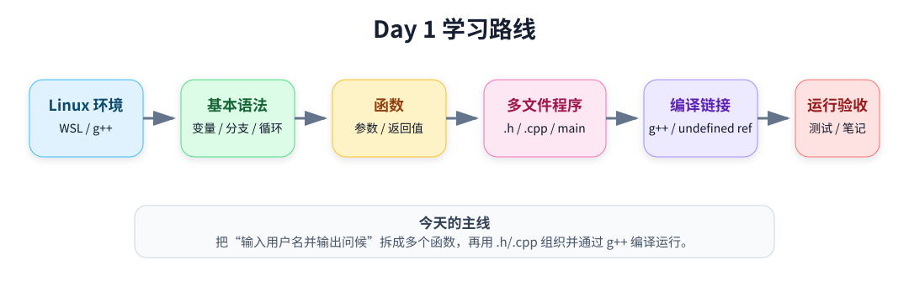

# Day 1 学习主干

> 主题：C++ 基本语法与多文件程序  
> 目标：能写、能编译、能运行、能解释。



## 1. 环境与今日目标

写一个命令行程序：

```text
输入用户名 → 生成问候语 → 输出 Hello, 用户名
```

最终交付：

```text
day1/
├── main.cpp
├── greet.h
├── greet.cpp
└── basics.cpp
```

核心效果：

```text
请输入用户名: Alice Wang
Hello, Alice Wang
```

### 1.1 从 WSL 连接 VS Code

1. 在 Windows 中安装 VS Code，并安装 **WSL** 扩展（Microsoft）。
2. 连接 WSL 的两种方式：
   - 点击 VS Code 左下角 `><`，选择 `Connect to WSL`；
   - 或按 `Ctrl + Shift + P`，执行 `WSL: Connect to WSL`。
3. 连接成功后，左下角应显示 `WSL: Ubuntu`。
4. 选择 `File → Open Folder`，打开：

```text
/home/你的用户名/cpp-learning/week1/day01
```

5. 按下面的组合键打开 VS Code 集成终端，确认提示符类似：

```text
Ctrl + `
```

```text
dyh@DESKTOP:/home/dyh/cpp-learning/week1/day01$
```

6. 执行：

```bash
pwd
g++ --version
```

如果终端显示 `PS C:\...`，说明仍在 PowerShell 中，需要重新连接 WSL。

关键区别：

```text
VS Code = 编辑器
WSL Ubuntu = Linux 环境、文件系统和编译器
```

详细步骤和排错方法见 `02-详细知识点.md`。

## 2. 学习主线

```text
Linux/WSL 环境
→ 变量、分支、循环
→ 函数、参数、返回值
→ 用 .h/.cpp 拆分程序
→ 用 g++ 编译和链接
→ 运行、测试、排查错误
→ 写学习笔记
```

## 3. 六个核心结论

1. **程序从 `main()` 开始执行。**
2. **变量保存数据，分支和循环控制流程。**
3. **函数封装一段可复用的逻辑，通过参数接收数据、通过返回值交出结果。**
4. **`.h` 放函数声明，`.cpp` 放函数实现。**
5. **编译解决“语法和声明”，链接解决“函数实现在哪里”。**
6. **`getline` 读取整行，`cin >>` 遇到空格会停止。**

## 4. 今日时间安排

| 时间 | 内容 |
|---|---|
| 20 分钟 | 进入 WSL、连接 VS Code、安装 `g++` |
| 25 分钟 | 学习变量、分支、循环、输入输出 |
| 25 分钟 | 完成 `basics.cpp` 小练习 |
| 45 分钟 | 编写 `readName`、`buildGreeting`、`printGreeting` |
| 35 分钟 | 拆分 `main.cpp`、`greet.h`、`greet.cpp` 并编译 |
| 15 分钟 | 故意制造并修复错误 |
| 20 分钟 | 运行验收、写笔记 |

## 5. 今天的程序结构

```text
main.cpp
  ├── 调用 readName()      读取用户名
  ├── 调用 buildGreeting() 生成问候语
  └── 调用 printGreeting() 输出结果

greet.h
  └── 声明三个函数

greet.cpp
  └── 实现三个函数
```

对应的函数接口：

```cpp
std::string readName();
std::string buildGreeting(const std::string& name);
void printGreeting(const std::string& message);
```

## 6. 编译与运行

编译命令：

```bash
g++ -std=c++17 -Wall -Wextra -pedantic main.cpp greet.cpp -o greet
```

运行命令：

```bash
./greet
```

测试要求：

- [ ] 输入 `Alice`，输出 `Hello, Alice`
- [ ] 输入 `Alice Wang`，输出完整名字
- [ ] 中文用户名正常显示
- [ ] 空输入会重新提示
- [ ] 能解释 `.h` 和 `.cpp` 的区别
- [ ] 能解释 `undefined reference`

## 7. 和 TinyWebServer 的关系

| 今日知识 | 原项目中的体现 |
|---|---|
| `main.cpp` 是入口 | `TinyWebServer/main.cpp` |
| `.h` 放声明 | `webserver.h`、`http_conn.h` |
| `.cpp` 放实现 | `webserver.cpp`、`http_conn.cpp` |
| 多源文件编译 | `makefile` 编译多个 `.cpp` |
| `main()` 组织流程 | 初始化、监听、事件循环 |

今天只建立“入口、声明、实现、编译链接”的整体认识，不深入类、线程池和网络模块。


