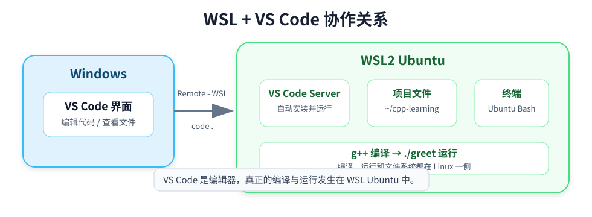
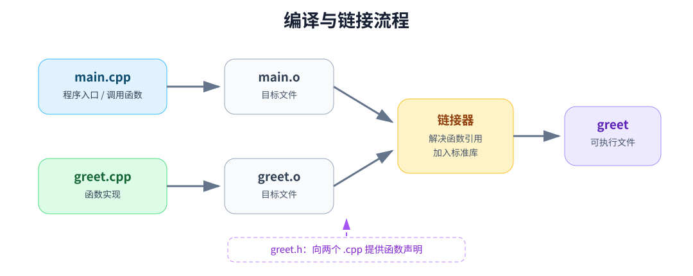

# Day 1 详细知识点

## 0. WSL 与 VS Code 如何配合



先分清两个角色：

| 部分 | 作用 |
|---|---|
| Windows 上的 VS Code | 编辑器，负责写代码、查看文件 |
| WSL2 Ubuntu | 真正的 Linux 环境，负责保存文件、编译和运行 |
| VS Code Server | VS Code 自动放在 WSL 中运行的后台服务 |
| Ubuntu 集成终端 | 执行 `g++`、`./greet` 等命令 |

### 0.1 连接前确认

在 Ubuntu 终端中确认目录存在：

```bash
mkdir -p ~/cpp-learning/week1/day01
cd ~/cpp-learning/week1/day01
pwd
```

`pwd` 应该显示类似：

```text
/home/dyh/cpp-learning/week1/day01
```

同时在 VS Code 扩展面板中安装 **WSL** 扩展（Microsoft）。

### 0.2 让 VS Code 连接到 WSL

有两种方式。

#### 方式 A：从 VS Code 左下角连接

点击 VS Code 左下角的：

```text
><
```

然后选择：

```text
Connect to WSL
```

连接成功后，左下角会显示类似：

```text
WSL: Ubuntu
```

#### 方式 B：使用命令面板

按：

```text
Ctrl + Shift + P
```

输入：

```text
WSL: Connect to WSL
```

然后选择这个命令。

### 0.3 打开学习目录

连接 WSL 后，选择：

```text
File → Open Folder
```

输入 Linux 路径：

```bash
/home/你的用户名/cpp-learning/week1/day01
```

例如 Ubuntu 用户名是 `dyh`，就打开：

```bash
/home/dyh/cpp-learning/week1/day01
```

如果这个目录还不存在，可以在 VS Code 内置终端里创建：

```bash
mkdir -p ~/cpp-learning/week1/day01
```

也可以先在 Ubuntu 终端进入目录，再用快捷方式打开：

```bash
cd ~/cpp-learning/week1/day01
code .
```

### 0.4 在 VS Code 中打开终端

按：

```text
Ctrl + `
```

也就是键盘左上角的反引号键，通常位于数字 `1` 左边。

也可以使用菜单：

```text
Terminal → New Terminal
```

打开后，终端提示符应该类似：

```text
dyh@DESKTOP:/home/dyh/cpp-learning/week1/day01$
```

如果提示符显示的是 PowerShell，例如：

```text
PS C:\Users\dyh>
```

说明 VS Code 没有连接到 WSL。重新执行：

```text
Ctrl + Shift + P
→ WSL: Connect to WSL
```

### 0.5 验证环境

在 VS Code 集成终端中执行：

```bash
pwd
g++ --version
```

如果 `pwd` 显示 `/home/...` 这样的 Linux 路径，并且 `g++` 能显示版本，说明终端和编译环境都正确。

### 0.6 常见问题

| 问题 | 原因与处理 |
|---|---|
| `code: command not found` | 确认 Windows 已安装 VS Code，并在 VS Code 中安装 **WSL** 扩展 |
| 打开的目录不对 | 先在 Ubuntu 终端 `cd` 到目标目录，再执行 `code .` |
| 终端显示 PowerShell | 重新执行 `Ctrl + Shift + P → WSL: Connect to WSL`，再新建终端 |
| `g++: command not found` | 在 Ubuntu 中执行 `sudo apt install -y build-essential` |
| 文件路径是 `C:\...` | 当前可能打开了 Windows 文件夹，应打开 Linux 目录 `/home/...` |

### 0.7 最重要的原则

> VS Code 只是编辑器；真正的编译和运行必须在 WSL Ubuntu 终端中完成。

## 1. 程序入口：`main()`

C++ 程序从 `main()` 开始执行。

```cpp
int main()
{
    return 0;
}
```

- `main()` 是程序入口；
- 操作系统启动程序后调用它；
- `return 0` 表示正常结束；
- 其他函数只有被调用时才执行。

## 2. 变量和数据类型

| 类型 | 用途 | 示例 |
|---|---|---|
| `int` | 整数 | `int age = 18;` |
| `double` | 小数 | `double score = 92.5;` |
| `bool` | 真/假 | `bool passed = true;` |
| `char` | 单个字符 | `char grade = 'A';` |
| `std::string` | 文本 | `std::string name = "Tom";` |

要点：

- 先声明，再使用；
- 尽量在声明时初始化；
- `const` 表示值不能被修改；
- 后续服务器项目会大量使用 `std::string`。

## 3. 分支和循环

### `if / else`

```cpp
if (score >= 60)
{
    std::cout << "通过\n";
}
else
{
    std::cout << "未通过\n";
}
```

作用：根据条件选择不同执行路径。

### `for`

```cpp
for (int i = 1; i <= 3; ++i)
{
    std::cout << i << '\n';
}
```

作用：按固定次数或范围重复执行。

### `while`

```cpp
while (true)
{
    // 条件一直成立时重复执行
}
```

作用：在条件满足时持续循环。今天的空用户名校验使用了 `while`。

## 4. 函数、参数和返回值

基本形式：

```cpp
返回类型 函数名(参数列表)
{
    函数体
}
```

示例：

```cpp
int add(int a, int b)
{
    return a + b;
}
```

- 参数：把外部数据传入函数；
- 返回值：把函数结果交给调用者；
- `void`：函数不返回结果；
- 函数可以复用逻辑，避免代码堆在 `main()` 中。

### 值传递与常量引用

```cpp
void printByValue(std::string text);
void printByReference(const std::string& text);
```

- 值传递会复制一份实参；
- `const std::string&` 不复制，且函数内不能修改原字符串；
- 对大对象，常量引用通常更高效。

## 5. 头文件和源文件

| 文件 | 作用 |
|---|---|
| `.h` | 函数声明、类型声明、接口 |
| `.cpp` | 函数定义、具体实现 |
| `main.cpp` | 程序入口，组织调用流程 |

示例：

```cpp
// greet.h
#ifndef GREET_H
#define GREET_H

#include <string>

std::string readName();
std::string buildGreeting(const std::string& name);
void printGreeting(const std::string& message);

#endif
```

```cpp
// greet.cpp
#include "greet.h"

std::string buildGreeting(const std::string& name)
{
    return "Hello, " + name;
}
```

### 头文件保护

```cpp
#ifndef GREET_H
#define GREET_H

// 声明

#endif
```

作用：防止同一头文件被重复包含，导致重复声明或重复定义。

### 包含方式

```cpp
#include <iostream>  // 标准库或系统头文件
#include "greet.h"   // 自己项目中的头文件
```

## 6. 基本输入输出

```cpp
std::cout << "Hello\n";       // 输出
std::cin >> age;              // 读取一个“单词”或数字
std::getline(std::cin, name); // 读取一整行
std::cerr << "错误信息\n";    // 输出错误信息
```

### `cin >>` 和 `getline` 的区别

| 写法 | 行为 |
|---|---|
| `std::cin >> name` | 遇到空格、制表符或换行停止 |
| `std::getline(std::cin, name)` | 读取到换行为止，可保留空格 |

输入：

```text
Alice Wang
```

使用 `cin >>` 得到 `Alice`；使用 `getline` 得到 `Alice Wang`。

## 7. 编译和链接



```text
main.cpp ──编译──> main.o ─┐
                           ├──链接──> greet 可执行文件
greet.cpp ─编译──> greet.o ┘
```

- 编译：检查语法，把 `.cpp` 变成目标文件；
- 链接：把目标文件、函数实现和标准库组合成可执行文件；
- `.h` 通常不单独编译，而是被 `#include` 到 `.cpp` 中。

### 今天的编译命令

```bash
g++ -std=c++17 -Wall -Wextra -pedantic main.cpp greet.cpp -o greet
```

| 参数 | 作用 |
|---|---|
| `g++` | C++ 编译器驱动程序 |
| `-std=c++17` | 使用 C++17 标准 |
| `-Wall` | 开启常见警告 |
| `-Wextra` | 开启更多警告 |
| `-pedantic` | 严格遵循标准 |
| `main.cpp greet.cpp` | 要编译的源文件 |
| `-o greet` | 指定输出文件名 |

编译成功时通常没有输出，这表示没有错误或警告。

## 8. 常见错误

| 错误 | 常见原因 | 处理 |
|---|---|---|
| `No such file or directory` | 文件名或路径错误 | 用 `ls` 确认文件存在 |
| `readName was not declared` | 忘记包含头文件 | 检查 `#include "greet.h"` |
| `undefined reference` | 函数只有声明，没有链接实现 | 把对应 `.cpp` 加入编译 |
| `expected ';'` | 语句缺少分号 | 查看报错行及其上一行 |
| 中文乱码 | 编码或终端问题 | 确认使用 UTF-8 |
| `Permission denied` | 没有执行权限 | 检查文件是否为可执行文件 |

### 关键区别

```bash
g++ main.cpp -o greet
```

只编译 `main.cpp`，没有链接 `greet.cpp`，可能出现：

```text
undefined reference to `readName()`
```

正确方式是：

```bash
g++ main.cpp greet.cpp -o greet
```

## 9. 运行程序

```bash
./greet
```

- `.` 表示当前目录；
- `/greet` 表示当前目录下的 `greet` 文件；
- 当前目录通常不在 `PATH` 中，所以不能直接输入 `greet`。

## 10. 与 TinyWebServer 的对应关系

| Day 1 知识 | TinyWebServer |
|---|---|
| `main()` 是入口 | `main.cpp` |
| `.h` 放接口 | `webserver.h`、`http_conn.h` |
| `.cpp` 放实现 | `webserver.cpp`、`http_conn.cpp` |
| 多文件编译 | `makefile` |
| 函数组织流程 | 初始化、监听、事件循环 |

今天的重点不是读懂原项目，而是掌握它使用的基本代码组织方式。


