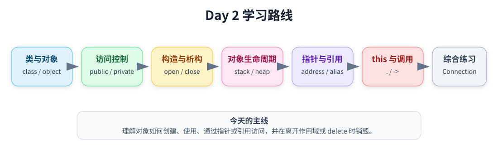

# Day 2 学习主干

> 主题：类、构造函数、析构函数、指针和引用  
> 目标：理解对象从创建到销毁的完整过程。



## 1. 今天要完成什么

写出并运行三个小程序：

```text
class_demo.cpp              类、对象、public/private、this
pointer_reference_demo.cpp  指针、引用、地址和解引用
connection_demo.cpp         构造函数、析构函数、栈对象、堆对象
```

最终理解：

```text
创建对象 → 调用构造函数 → 使用对象
→ 离开作用域或 delete → 调用析构函数 → 释放对象
```

## 2. 学习主线

```text
class 和 object
→ public / private
→ 构造函数
→ 析构函数
→ 栈对象和堆对象
→ 指针和引用
→ this、. 和 ->
→ 综合练习 Connection
```

## 3. 今日时间安排

| 时间 | 内容 |
|---|---|
| 10 分钟 | 回顾 Day 1，创建 Day 2 目录 |
| 20 分钟 | 学习类和对象、公有和私有成员 |
| 25 分钟 | 编写 `class_demo.cpp` |
| 30 分钟 | 学习构造函数、析构函数和生命周期 |
| 30 分钟 | 学习指针、引用、`this`、`.` 和 `->` |
| 25 分钟 | 编写 `pointer_reference_demo.cpp` |
| 25 分钟 | 编写 `connection_demo.cpp` |
| 15 分钟 | 制造并修复错误 |
| 10 分钟 | 验收和写笔记 |

## 4. 七个核心结论

1. **类是设计图，对象是具体实例。**
2. **`public` 对外开放，`private` 只在类内部访问。**
3. **构造函数在对象创建时自动执行。**
4. **析构函数在对象销毁时自动执行。**
5. **栈对象离开作用域时析构，堆对象在 `delete` 时析构。**
6. **指针保存地址，引用是别名。**
7. **对象和引用使用 `.`，对象指针使用 `->`，`this` 指向当前对象。**

## 5. 今日目录

```text
~/cpp-learning/week1/day02/
├── class_demo.cpp
├── pointer_reference_demo.cpp
├── connection_demo.cpp
└── notes.md
```

进入目录：

```bash
mkdir -p ~/cpp-learning/week1/day02
cd ~/cpp-learning/week1/day02
code .
```

## 6. 编译与运行

```bash
g++ -std=c++17 -Wall -Wextra -pedantic class_demo.cpp -o class_demo
g++ -std=c++17 -Wall -Wextra -pedantic pointer_reference_demo.cpp -o pointer_reference_demo
g++ -std=c++17 -Wall -Wextra -pedantic connection_demo.cpp -o connection_demo

./class_demo
./pointer_reference_demo
./connection_demo
```

## 7. 综合程序结构

```text
Connection 类
├── 构造函数：输出 open fd=...
├── 析构函数：输出 close fd=...
├── show()：输出连接信息
└── private fd_：保存文件描述符编号

main()
├── 创建栈对象，观察自动析构
├── 创建堆对象，观察 delete 时析构
└── 使用 . 和 -> 调用成员函数
```

## 8. 验收标准

- [ ] `class_demo` 能编译运行
- [ ] `pointer_reference_demo` 能展示指针和引用修改变量
- [ ] `connection_demo` 中 `open/close` 顺序正确
- [ ] 能解释构造函数和析构函数的执行时机
- [ ] 能解释栈对象和堆对象的区别
- [ ] 能解释指针和引用的区别
- [ ] 能解释 `.`、`->` 和 `this`

## 9. 和 TinyWebServer 的关系

| Day 2 知识 | TinyWebServer 中的体现 |
|---|---|
| 类 | `WebServer`、`http_conn` |
| 构造函数 | `WebServer()`、`http_conn()` |
| 析构函数 | `~WebServer()`、`~http_conn()` |
| 对象 | `WebServer server;` |
| 指针 | `http_conn *users` |
| 引用参数 | `bool& timeout`、`bool& stop_server` |
| `->` | 通过对象指针调用成员 |

今天只需认出这些结构，不要求读懂完整服务器代码。
