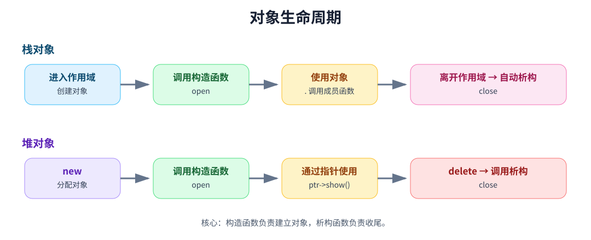
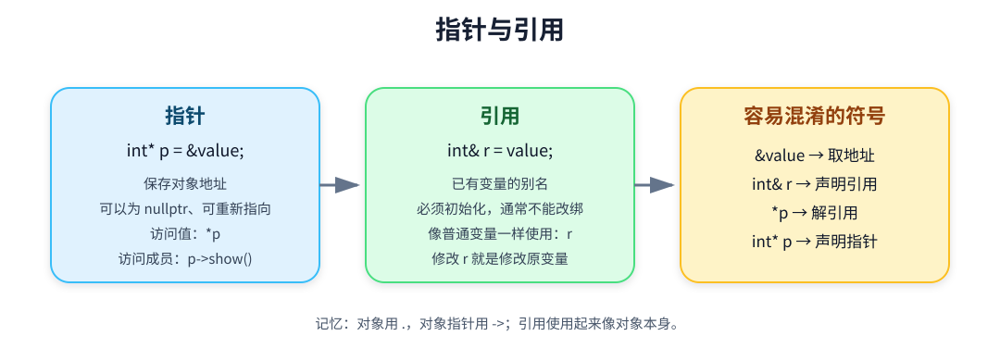

# Day 2 详细知识点

## 1. 类和对象

类是类型和设计图，对象是根据类创建出来的实例。

```cpp
class User
{
public:
    void print()
    {
        std::cout << "user\n";
    }
};

int main()
{
    User user;   // 创建对象
    user.print(); // 对象使用 .
}
```

- `User` 是类；
- `user` 是对象；
- `print()` 是成员函数。

## 2. `public` 和 `private`

```cpp
class User
{
public:
    void setName(const std::string& name)
    {
        this->name = name;
    }

private:
    std::string name;
};
```

| 访问权限 | 含义 |
|---|---|
| `public` | 类外部可以访问 |
| `private` | 只有类自己的成员函数可以访问 |

目的：

- 保护内部数据；
- 让外部通过受控接口操作对象；
- 降低模块之间的耦合。

## 3. 构造函数

构造函数在对象创建时自动执行。

特点：

- 函数名和类名相同；
- 没有返回类型；
- 可以有参数；
- 可以有多个重载版本；
- 负责初始化对象。

```cpp
class User
{
public:
    User(const std::string& name)
    {
        this->name = name;
    }

private:
    std::string name;
};
```

创建对象时自动调用：

```cpp
User user("Alice");
```

## 4. 析构函数

析构函数在对象销毁时自动执行。

特点：

- 函数名是 `~类名`；
- 没有返回类型；
- 没有参数；
- 不能重载；
- 通常负责释放资源。

```cpp
class Resource
{
public:
    Resource()
    {
        std::cout << "open\n";
    }

    ~Resource()
    {
        std::cout << "close\n";
    }
};
```

## 5. 对象生命周期



### 栈对象

```cpp
{
    Resource resource;
}
```

- 进入作用域时构造；
- 离开作用域时自动析构。

### 堆对象

```cpp
Resource* ptr = new Resource();
delete ptr;
```

- `new`：分配内存并调用构造函数；
- `delete`：调用析构函数并释放内存。

如果只 `new` 不 `delete`，对象可能一直不析构，造成内存泄漏。

## 6. 指针

```cpp
int value = 10;
int* ptr = &value;
```

- `&value`：取地址；
- `ptr`：保存地址；
- `*ptr`：访问指针指向的值。

```cpp
*ptr = 20; // value 也变成 20
```

空指针：

```cpp
int* ptr = nullptr;
```

使用前应检查：

```cpp
if (ptr != nullptr)
{
    std::cout << *ptr << '\n';
}
```

## 7. 引用

```cpp
int value = 10;
int& ref = value;
```

- 引用是已有变量的别名；
- 必须在定义时初始化；
- 修改引用就是修改原变量；
- 通常不能改绑到另一个变量。

```cpp
ref = 20; // value 也变成 20
```

### 指针和引用对比



| 对比项 | 指针 | 引用 |
|---|---|---|
| 是否保存地址 | 保存地址 | 本质是别名 |
| 是否可以为空 | 可以是 `nullptr` | 通常必须有对象 |
| 是否可重新指向 | 可以 | 通常不可以 |
| 访问方式 | `*ptr`、`ptr->` | 像普通变量 |
| 常见用途 | 动态对象、数组、资源 | 函数参数、避免复制 |

## 8. `this`、`.` 和 `->`

`this` 指向当前正在执行成员函数的对象。

```cpp
class User
{
public:
    void rename(const std::string& name)
    {
        this->name = name;
    }

private:
    std::string name;
};
```

- `name` 是参数；
- `this->name` 是当前对象的成员；
- `this` 可以理解为指向当前对象的指针。

调用规则：

```text
对象或引用 → 使用 .
对象指针   → 使用 ->
```

```cpp
User user("Alice");
user.print();       // 对象使用 .

User* ptr = &user;
ptr->print();       // 指针使用 ->
```

`ptr->print()` 等价于：

```cpp
(*ptr).print();
```

## 9. 综合练习：`connection_demo.cpp`

```cpp
#include <iostream>

class Connection
{
public:
    Connection(int fd) : fd_(fd)
    {
        std::cout << "open fd=" << fd_ << '\n';
    }

    ~Connection()
    {
        std::cout << "close fd=" << fd_ << '\n';
    }

    void show() const
    {
        std::cout << "connection fd=" << fd_ << '\n';
    }

private:
    int fd_;
};

int main()
{
    std::cout << "--- stack ---\n";

    {
        Connection conn(3);
        conn.show();
    }

    std::cout << "--- heap ---\n";

    Connection* ptr = new Connection(4);
    ptr->show();
    delete ptr;

    std::cout << "--- end ---\n";
    return 0;
}
```

预期输出：

```text
--- stack ---
open fd=3
connection fd=3
close fd=3
--- heap ---
open fd=4
connection fd=4
close fd=4
--- end ---
```

这个程序同时包含：

- 类、对象；
- 私有成员；
- 构造函数；
- 析构函数；
- 栈对象；
- 堆对象；
- `new/delete`；
- 指针；
- `.` 和 `->`。

## 10. 编译与运行

```bash
g++ -std=c++17 -Wall -Wextra -pedantic connection_demo.cpp -o connection_demo
./connection_demo
```

编译成功时通常没有输出，这表示没有错误或警告。

## 11. 常见错误

| 错误 | 原因 | 处理 |
|---|---|---|
| 类定义末尾缺少 `;` | `class` 定义需要分号 | 在 `}` 后加 `;` |
| 访问私有成员失败 | 从类外部访问 `private` | 通过公有成员函数访问 |
| 指针对象使用 `.` | 指针应使用 `->` | 改为 `ptr->show()` |
| `delete` 后继续访问 | 指针悬空 | 不再使用，或置为 `nullptr` |
| 忘记 `delete` | 堆对象未释放 | 保持 `new/delete` 配对 |
| 引用未初始化 | 引用必须绑定对象 | `int& ref = value;` |
| 构造函数写了返回类型 | 构造函数不能有返回类型 | 删除返回类型 |

## 12. 与 TinyWebServer 的对应关系

| Day 2 知识 | 原项目中的体现 |
|---|---|
| 类 | `WebServer`、`http_conn` |
| 构造函数 | `WebServer()`、`http_conn()` |
| 析构函数 | `~WebServer()`、`~http_conn()` |
| 对象 | `WebServer server;` |
| 指针 | `http_conn *users` |
| 引用参数 | `bool& timeout`、`bool& stop_server` |
| `->` | 通过对象指针调用成员函数 |

今天的目标是认识这些结构及其生命周期，不是读懂服务器全部实现。
