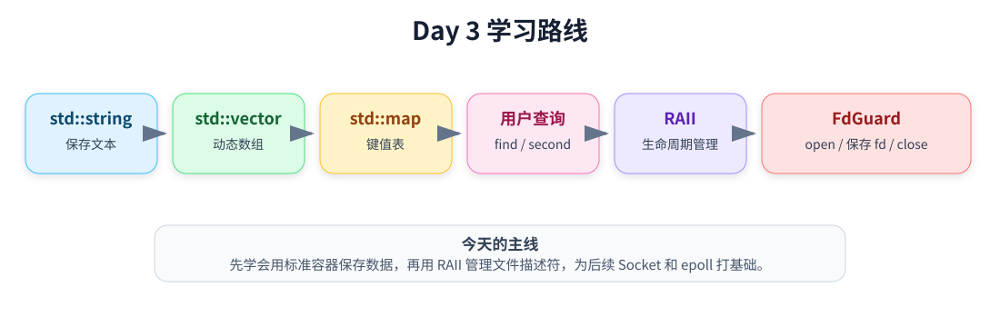

# Day 3 学习主干

> 主题：`std::string`、`std::vector`、`std::map` 和 RAII  
> 目标：学会用容器保存数据，并用对象生命周期自动管理资源。



## 1. 今天要完成什么

写出并运行三个程序：

```text
string_vector_demo.cpp   字符串和动态数组
user_map_demo.cpp        用户名 → 密码查询
fd_guard_demo.cpp        使用 RAII 自动关闭文件描述符
```

最终理解：

```text
构造函数获取资源
→ 对象使用期间资源有效
→ 析构函数释放资源
```

## 2. 学习主线

```text
std::string
→ std::vector
→ std::map
→ 容器的增删改查
→ RAII
→ FdGuard
→ 文件描述符 fd
```

## 3. 今日时间安排

| 时间 | 内容 |
|---|---|
| 10 分钟 | 回顾 Day 2，创建 Day 3 目录 |
| 25 分钟 | 学习 `std::string` |
| 30 分钟 | 学习 `std::vector` 并完成练习 |
| 30 分钟 | 学习 `std::map` 并完成用户查询 |
| 25 分钟 | 学习 RAII 思想 |
| 30 分钟 | 编写 `FdGuard` |
| 15 分钟 | 制造并修复错误 |
| 15 分钟 | 验收、口述和写笔记 |

## 4. 七个核心结论

1. **`string` 保存文本，`vector` 保存动态数组，`map` 保存键值对。**
2. **`vector` 比普通数组更灵活，并自动管理内部内存。**
3. **`map` 适合保存“用户名 → 密码”这种对应关系。**
4. **查询 `map` 应优先使用 `find()`。**
5. **`users["unknown"]` 可能会插入一个新元素。**
6. **RAII 把资源生命周期绑定到对象生命周期。**
7. **`fd` 是操作系统分配的资源编号，`close()` 释放对应的系统资源。**

## 5. 今日目录

```text
~/cpp-learning/week1/day03/
├── string_vector_demo.cpp
├── user_map_demo.cpp
├── fd_guard_demo.cpp
└── notes.md
```

进入目录：

```bash
mkdir -p ~/cpp-learning/week1/day03
cd ~/cpp-learning/week1/day03
code .
```

## 6. 编译与运行

```bash
g++ -std=c++17 -Wall -Wextra -pedantic string_vector_demo.cpp -o string_vector_demo
g++ -std=c++17 -Wall -Wextra -pedantic user_map_demo.cpp -o user_map_demo
g++ -std=c++17 -Wall -Wextra -pedantic fd_guard_demo.cpp -o fd_guard_demo

./string_vector_demo
./user_map_demo
./fd_guard_demo
```

## 7. 三个程序的结构

```text
string_vector_demo
├── string 拼接、查找
└── vector 添加、遍历、删除

user_map_demo
├── map 保存三个用户
├── getline 读取用户名
└── find 查询密码

fd_guard_demo
├── FdGuard 构造函数 open()
├── fd_ 保存文件描述符
├── get() 返回 fd
└── 析构函数 close()
```

## 8. 验收标准

- [ ] 三个程序都能编译运行
- [ ] 能用 `map` 查询 `admin` 的密码
- [ ] 能解释 `find()` 和 `operator[]` 的区别
- [ ] 能解释 `vector` 和普通数组的区别
- [ ] 能解释 RAII 的含义
- [ ] 能解释 `FdGuard` 为什么不用手动 `close()`
- [ ] 能解释 fd 是什么，以及 `close()` 做了什么

## 9. 和 TinyWebServer 的关系

| Day 3 知识 | TinyWebServer 中的体现 |
|---|---|
| `std::string` | 用户名、密码、请求路径等文本 |
| `std::map` | `map<string, string> users` 保存用户信息 |
| `find()` | `users.find(name) != users.end()` |
| RAII | `connectionRAII mysqlcon(...)` |
| 构造函数获取资源 | 从数据库连接池获取连接 |
| 析构函数释放资源 | 自动把连接归还连接池 |
| fd | 文件、Socket、epoll 实例都用 fd 表示 |

今天只需理解资源管理思想，不要求读懂完整数据库连接池。
