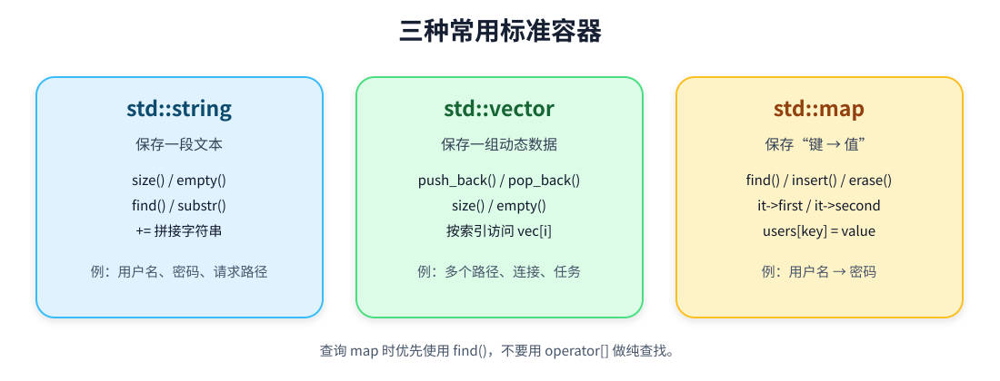
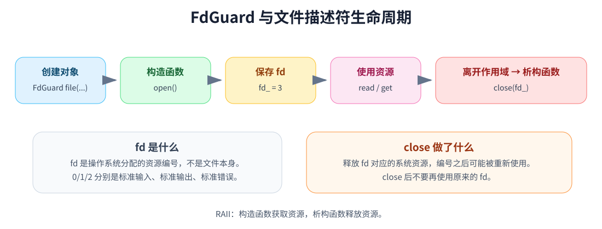

# Day 3 详细知识点

## 1. `std::string`

`std::string` 用来保存文本。

```cpp
#include <string>

std::string name = "Alice";
```

常用操作：

```cpp
std::string text = "hello";

text.size();       // 字符数量
text.empty();      // 是否为空
text += " world";  // 拼接
text.find("world"); // 查找，找不到返回 npos
text.substr(0, 5); // 截取子串
```

示例：

```cpp
if (text.find("world") != std::string::npos)
{
    std::cout << "found\n";
}
```

`std::string` 会自动管理内部字符内存，离开作用域时自动释放。

## 2. `std::vector`

`std::vector` 是可以动态增长的数组。



```cpp
#include <vector>
#include <string>

std::vector<std::string> paths;

paths.push_back("/");
paths.push_back("/index.html");
paths.push_back("/favicon.ico");

std::cout << paths.size() << '\n';

for (const std::string& path : paths)
{
    std::cout << path << '\n';
}

paths.pop_back();
```

常用操作：

| 操作 | 作用 |
|---|---|
| `push_back()` | 末尾添加元素 |
| `pop_back()` | 删除最后一个元素 |
| `size()` | 返回元素数量 |
| `empty()` | 判断是否为空 |
| `clear()` | 清空所有元素 |
| `paths[i]` | 按索引访问 |

`vector` 和普通数组的区别：

- 普通数组大小固定；
- `vector` 可以动态增长；
- `vector` 自动管理内部内存；
- `vector` 可以通过 `size()` 获取当前元素数量。

## 3. `std::map`

`std::map` 保存“键 → 值”的对应关系。

```cpp
#include <map>
#include <string>

std::map<std::string, std::string> users;

users["admin"] = "123456";
users["alice"] = "alice123";
users["bob"] = "bob123";
```

### 查找

```cpp
auto it = users.find("alice");

if (it != users.end())
{
    std::cout << it->first << '\n';  // alice
    std::cout << it->second << '\n'; // alice123
}
```

- `it->first`：键；
- `it->second`：值；
- `users.end()`：没有找到。

### 插入

```cpp
users.insert(std::pair<std::string, std::string>("tom", "tom123"));
```

### 删除

```cpp
users.erase("bob");
```

### 遍历

```cpp
for (const auto& entry : users)
{
    std::cout << entry.first << " -> " << entry.second << '\n';
}
```

### `operator[]` 的陷阱

```cpp
std::string password = users["unknown"];
```

如果 `unknown` 不存在，这行代码会自动插入一个空的字符串值。

因此，**查询用户时应优先使用 `find()`**。

## 4. RAII

RAII 的英文是：

```text
Resource Acquisition Is Initialization
资源获取即初始化
```

更准确的理解是：

> 把资源的生命周期绑定到对象的生命周期上。

```text
构造函数：获取资源
对象使用期间：资源有效
析构函数：释放资源
```

`std::string`、`std::vector`、`std::map` 都通过 RAII 自动管理内部内存。

## 5. `FdGuard` 与文件描述符



文件描述符 `fd` 是操作系统分配的资源编号。

```text
0：标准输入
1：标准输出
2：标准错误
3、4、5……：打开的文件、Socket、管道等
```

`fd` 不是文件本身，只是访问资源的编号。

### `open()`

```cpp
int fd = open(path.c_str(), O_RDONLY);
```

- `open()` 是 Linux 系统调用；
- `path.c_str()` 把 `std::string` 转成 C 风格字符串；
- `O_RDONLY` 表示只读打开；
- 成功返回非负 fd；
- 失败返回 `-1`。

### `close()`

```cpp
close(fd);
```

`close()` 告诉操作系统：

> 这个 fd 对应的资源不再使用，可以回收。

`close()` 之后不能再继续使用原来的 fd。fd 编号之后可能被新的 `open()` 或 `socket()` 重复使用。

### `FdGuard`

```cpp
class FdGuard
{
public:
    FdGuard(const std::string& path)
    {
        fd_ = open(path.c_str(), O_RDONLY);

        if (fd_ == -1)
        {
            std::cerr << "open failed: " << path << '\n';
        }
        else
        {
            std::cout << "open fd=" << fd_ << '\n';
        }
    }

    ~FdGuard()
    {
        if (fd_ != -1)
        {
            std::cout << "close fd=" << fd_ << '\n';
            close(fd_);
        }
    }

    int get() const
    {
        return fd_;
    }

private:
    int fd_;
};
```

执行流程：

```text
创建 FdGuard 对象
→ 构造函数 open()
→ fd_ 保存文件描述符
→ main 使用资源
→ 对象离开作用域
→ 析构函数 close()
```

关键区别：

```text
fd_ 变量本身：对象销毁时消失
fd 对应的系统资源：由 close() 释放
```

如果忘记 `close()`，文件描述符会泄漏。进程退出时 Linux 会清理仍然打开的 fd，但长期运行的服务器不能依赖进程退出。

## 6. 完整示例：`fd_guard_demo.cpp`

```cpp
#include <fcntl.h>
#include <unistd.h>

#include <iostream>
#include <string>

class FdGuard
{
public:
    FdGuard(const std::string& path)
    {
        fd_ = open(path.c_str(), O_RDONLY);

        if (fd_ == -1)
        {
            std::cerr << "open failed: " << path << '\n';
        }
        else
        {
            std::cout << "open fd=" << fd_ << '\n';
        }
    }

    ~FdGuard()
    {
        if (fd_ != -1)
        {
            std::cout << "close fd=" << fd_ << '\n';
            close(fd_);
        }
    }

    int get() const
    {
        return fd_;
    }

private:
    int fd_;
};

int main()
{
    FdGuard file("/etc/passwd");

    if (file.get() != -1)
    {
        std::cout << "resource is in use\n";
    }

    return 0;
}
```

预期输出：

```text
open fd=3
resource is in use
close fd=3
```

fd 编号不一定是 3，具体由操作系统分配。

## 7. 常见错误

| 错误 | 原因 | 处理 |
|---|---|---|
| `string` 未定义 | 没包含 `<string>` | 加 `#include <string>` |
| `vector` 未定义 | 没包含 `<vector>` | 加 `#include <vector>` |
| `map` 未定义 | 没包含 `<map>` | 加 `#include <map>` |
| `open` 未定义 | 没包含 `<fcntl.h>` | 加 `#include <fcntl.h>` |
| `close` 未定义 | 没包含 `<unistd.h>` | 加 `#include <unistd.h>` |
| 查询 `map` 后元素变多 | 使用了 `users[name]` | 查询用 `find()` |
| `vector[i]` 越界 | `[]` 不检查边界 | 确保 `i < vector.size()` |
| fd 被重复关闭 | 手动 `close` 后析构又关闭 | 统一交给 `FdGuard` 管理 |

## 8. 与 TinyWebServer 的对应关系

```cpp
map<string, string> users;
```

用于保存用户名和密码：

```cpp
users[name] = password;

if (users.find(name) != users.end())
{
    // 用户存在
}
```

```cpp
connectionRAII mysqlcon(&request->mysql, m_connPool);
```

核心过程：

```text
connectionRAII 构造
→ 从连接池获取数据库连接

connectionRAII 析构
→ 自动把连接归还连接池
```

简化示意：

```cpp
connectionRAII::connectionRAII(MYSQL **SQL, connection_pool *connPool)
{
    *SQL = connPool->GetConnection();
    conRAII = *SQL;
    poolRAII = connPool;
}

connectionRAII::~connectionRAII()
{
    poolRAII->ReleaseConnection(conRAII);
}
```

今天不需要理解 MySQL 连接池细节，只需要掌握：

> 构造函数获取资源，析构函数释放资源。
